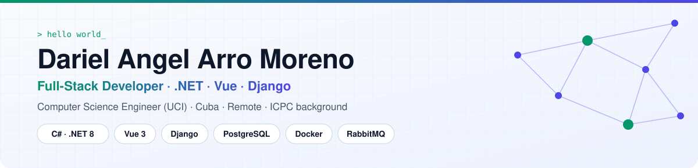
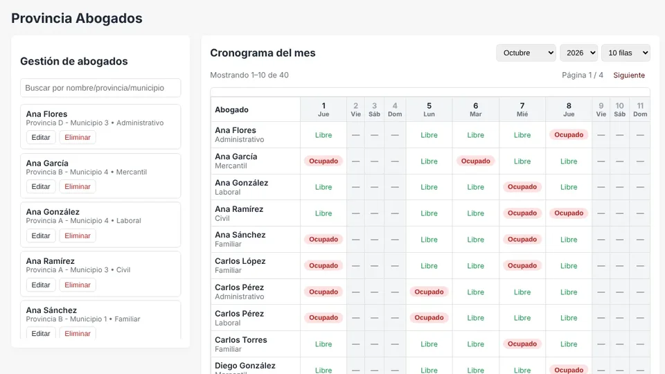
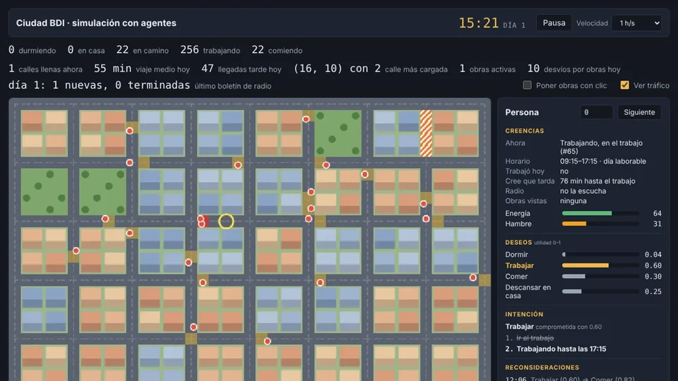
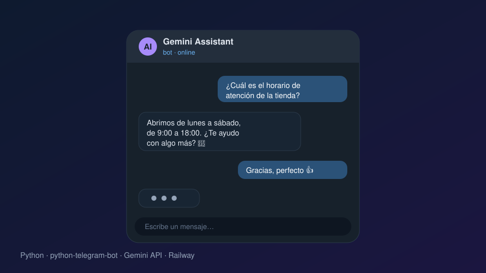

<picture>
  <source media="(prefers-color-scheme: dark)" srcset="assets/banner-dark.svg">
  
</picture>

  
  
  
  
  

<a href="README.md">🇬🇧 Read in English</a> · 🇪🇸 Español

---

## 👨‍💻 Sobre mí

Soy **ingeniero en Ciencias Informáticas** (Universidad de las Ciencias Informáticas, 2025) y trabajo como **desarrollador de software en XEJEL**. Construyo sistemas completos de punta a punta: diseño la base de datos, escribo la API, hago la interfaz y lo dejo funcionando en un servidor, con pruebas automáticas, CI y monitoreo.

- 🛒 Mi proyecto más grande es una **tienda en línea con microservicios**: 11 servicios .NET 8, tienda y panel de administración en Vue 3, eventos con RabbitMQ, PayPal y **más de 750 pruebas automáticas** en GitHub Actions.
- ⚖️ Hice un **sistema de agenda para los abogados de una provincia** con Express + Vue 3 y luego lo migré por completo a **Django** conservando la misma base de datos.
- 🧠 Me gustan los algoritmos y la IA: fui competidor del **ICPC**, colaboré en la traducción al español de **cp-algorithms** y creé una **simulación de ciudad con agentes BDI** que corre en el navegador.
- 🤖 Uso asistentes de IA (Claude, Copilot) para avanzar más rápido: **yo decido la arquitectura, reviso cada cambio y lo cubro con pruebas.**
- 🌎 Desde Cuba (UTC−5/−4, igual que la costa este de EE. UU.) · 🗣️ Español nativo, inglés B1 (técnico y escrito).

## 🛠️ Tecnologías

<table>
  <tr>
    <td align="center" width="150"><b>Backend</b></td>
    <td> ASP.NET Core · EF Core · Clean Architecture · CQRS / MediatR · REST · JWT · YARP</td>
  </tr>
  <tr>
    <td align="center"><b>Frontend</b></td>
    <td> Vue 3 · Pinia · Vue Router · Chart.js · PWA · i18n · Next.js / shadcn (hackatón)</td>
  </tr>
  <tr>
    <td align="center"><b>Datos y mensajería</b></td>
    <td> PostgreSQL (una BD por servicio) · SQLite · Sequelize · optimización de consultas · integración por eventos</td>
  </tr>
  <tr>
    <td align="center"><b>DevOps y calidad</b></td>
    <td> Docker Compose · Ubuntu Server · xUnit · Testcontainers · Vitest · Playwright</td>
  </tr>
  <tr>
    <td align="center"><b>IA y algoritmos</b></td>
    <td> API de Gemini · bots de Telegram · automatización con n8n · scikit-learn · Jupyter · agentes BDI · A* · ICPC</td>
  </tr>
</table>

## 🚀 Proyectos destacados

<table>
  <tr>
    <td width="50%" valign="top">
      
      <h3><a href="https://github.com/DarielAngel/ecommerce-microservicios">🛒 Tienda en línea con microservicios</a></h3>
      Tienda completa: catálogo con búsqueda, carrito, pago con <b>PayPal</b>, seguimiento de pedidos, devoluciones con reembolso, cupones, puntos de lealtad, reseñas y lista de deseos. Se instala como <b>PWA</b> y se gestiona desde un panel.
        
      <code>11 servicios .NET 8</code> <code>Vue 3</code> <code>PostgreSQL ×11</code> <code>RabbitMQ</code> <code>YARP gateway</code> <code>750+ pruebas</code>
        
      
    </td>
    <td width="50%" valign="top">
      
      <h3><a href="https://github.com/DarielAngel/DistribucionAbogadosTPPGpython3">⚖️ Sistema de agenda para abogados</a></h3>
      Reparte el trabajo entre los abogados de una provincia: calendario mensual por persona, asignación de tareas sin choques, días no laborables configurables, búsqueda instantánea y roles.
        
      <code>Express + Vue 3</code> → <code>Django</code> <code>Vitest</code> <code>Playwright</code> <code>Docker</code>
        
      <a href="https://github.com/DarielAngel/DistribucionAbogadosTPPG">v1 · Node/Vue</a> · <a href="https://github.com/DarielAngel/DistribucionAbogadosTPPGpython3">v2 · Django</a>
    </td>
  </tr>
  <tr>
    <td width="50%" valign="top">
      
      <h3><a href="https://github.com/DarielAngel/ciudad-bdi">🧠 Ciudad BDI — simulación con agentes</a></h3>
      Una ciudad vista desde arriba donde <b>300 agentes BDI</b> (creencias, deseos e intenciones) van al trabajo, comen, descansan, sufren atascos y esquivan obras. La hora punta surge de sus decisiones; las rutas usan <b>A*</b> según el tráfico.
        
      <code>JavaScript puro</code> <code>Canvas</code> <code>A*</code> <code>Determinista</code> <code>Sin dependencias</code>
        
      
    </td>
    <td width="50%" valign="top">
      
      <h3><a href="https://github.com/DarielAngel/AgentGeminiAI">🤖 Asistente de IA en Telegram</a></h3>
      Bot de Telegram que responde con <b>Google Gemini</b>. Incluye scripts para comparar proveedores de IA (Gemini, Cerebras, OpenRouter) por calidad y costo; desplegado en la nube con <b>Railway</b>.
        
      <code>Python</code> <code>python-telegram-bot</code> <code>Gemini API</code> <code>Railway</code>
    </td>
  </tr>
</table>

<b>📂 Más proyectos</b>

 

| Proyecto | Qué es | Tecnologías |
|---|---|---|
| [EasyPOS](https://github.com/DarielAngel/EasyPOS/tree/master) | API de punto de venta con Clean Architecture, CQRS y pruebas unitarias por caso de uso | .NET 8 · MediatR · FluentValidation · ErrorOr · EF Core · xUnit |
| [TaskMaster API](https://github.com/DarielAngel/Projects-Net) | API REST de tareas hecha en XEJEL: arquitectura en capas y patrón repositorio | ASP.NET Core · EF Core · SQLite |
| [Autenticación con ASP.NET Identity](https://github.com/DarielAngel/AuthenticationNetFrameworkInTwoLines/tree/master) | Registro, inicio de sesión y tokens en una API mínima | ASP.NET Identity · PostgreSQL |
| [Panel de planificación (tesis)](https://github.com/DarielAngel/Dashboard-SIPAC) | Planificación y control de actividades institucionales con gráficos y varios idiomas | Vue 3 · Tailwind · Chart.js · Django API |
| [Modelos de aprendizaje automático](https://github.com/DarielAngel/Inteligencia-Artificial) | Árboles y bosques de decisión y redes neuronales sobre datos reales | Python · scikit-learn · Jupyter |
| [CP-Algorithms en español](https://cp-algorithms-es.github.io) | Colaboración en la traducción al español de cp-algorithms.com | Algorithms · Markdown |
| [Portafolio](https://github.com/DarielAngel/DarielAngel.github.io) | Portafolio bilingüe, modo claro/oscuro, basado en datos | HTML · CSS · JavaScript |

## 💼 Experiencia

**Desarrollador de software — XEJEL · Universidad de las Ciencias Informáticas** · *2025 – actualidad*
- APIs REST con Clean Architecture, Entity Framework Core y patrón repositorio.
- Despliegue de servicios en Ubuntu Server con Docker Compose; monitoreo con Prometheus + Grafana para detectar y diagnosticar incidentes.
- Evaluaciones de usabilidad de las plataformas XEJEL y Moodle, con informes para reducir errores y simplificar la interfaz.

**Ingeniería en Ciencias Informáticas — UCI** · *Graduado en 2025*
- Tesis: panel de planificación institucional (Vue 3 + Django + PostgreSQL) con optimización de consultas.
- Representante de la universidad en competencias de programación **ICPC**.

## 🔭 Ahora mismo

- 🏆 Desarrollo el frontend en **Next.js 16 / React 19** de *NexoChain*, una plataforma de trazabilidad de lotes con códigos QR (equipo de hackatón, backend en Spring).
- 🛒 Sigo ampliando la tienda en línea: nuevos módulos en la [hoja de ruta pública](https://github.com/DarielAngel/ecommerce-microservicios/blob/main/docs/ROADMAP-FUNCIONALIDADES.md).
- 📚 Mejorando mi inglés y profundizando en sistemas distribuidos y automatización con **n8n**.

## 📊 Estadísticas

  
  

---

**💬 ¿Tienes un proyecto o una vacante?** Escríbeme a **[darielarrom@gmail.com](mailto:darielarrom@gmail.com)** o por **[Telegram](https://t.me/darielangel)**: respondo en menos de 24 h.

